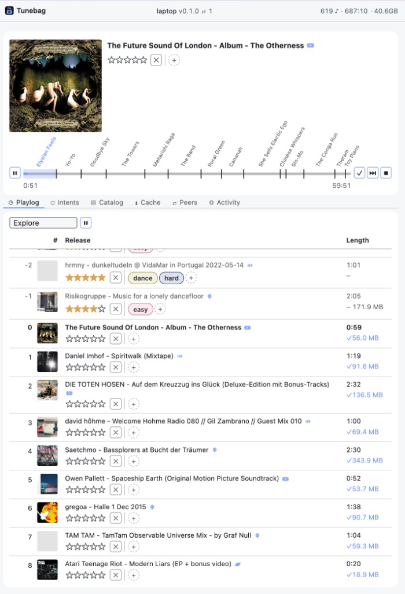
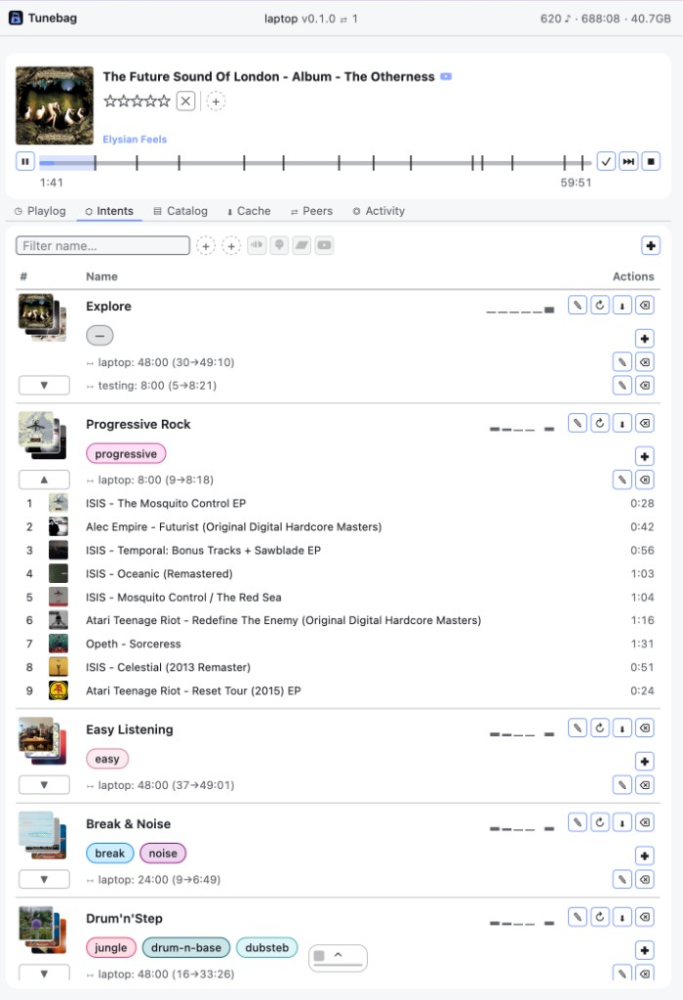

# Tunebag

**Music packed for every device.**

Tunebag is an offline-first music player for people who listen across platforms and machines. You plan what you want to hear, for how long, and on which device — Tunebag keeps the shared catalog in sync and caches only the audio each device actually needs.

No central server. Paired devices exchange a signed event log over LAN (or a pasted locator). Audio stays local, fetched from peers when possible and from the origin otherwise.

<p align="center">
  
  &nbsp;
  
</p>

## Why

Listening often spans SoundCloud mixes, hearthis sets, Bandcamp albums, YouTube releases — and more than one device. Streaming assumes a good network; packing a bag for the train does not. Tunebag treats **hours on a device** as the unit of packing: the full catalog syncs everywhere; each machine only downloads what its plan requires.

## Concepts

### Catalog and Releases

The **Catalog** is fully replicated metadata on every paired device: artists, releases, tags, ratings, rejects, playheads, intents, sequences, and assignments. It is derived only from the **Event log** — a signed, append-only stream of changes. Same events ⇒ same catalog, independent of apply order (deterministic merge).

A **Release** is one listening item: either a **Mix** (single file, e.g. a DJ set) or an **Album** (ordered tracks). Played, skip, reject, rating, tags, and playhead attach to the Release as a whole.

Supported ingest today includes SoundCloud and hearthis (Mixes), Bandcamp and YouTube / YouTube Music (Albums).

### Intent, Sequence, Assignment

An **Intent** is a listening plan:

- *what* — tag filter (OR), optional artist filter, platform filter, and a rating draw distribution (5★ … 1★ + unrated)
- *how much* — hours per device, with optional expiry

From an Intent, Tunebag builds a seeded **Sequence** (ordered releases) large enough for the biggest device budget. An **Assignment** maps each device’s hours onto a prefix of that sequence. Smaller budgets take the front of the same shared queue (2h phone ≡ first 2h of an 8h laptop plan).

### Cache (audio)

**Files** (audio bytes) are local only. The **Cache** fills assigned releases in urgency order: peer / USB first when available, then origin. On a **metered** link, fill caps at the current release + one ahead per intent (with a one-shot “Fill now” override). Catalog sync is never gated on metered mode.

### Devices and pairing

A **Device** has a stable identity (`device_id` + keypair). Network addresses are **Locators** — ephemeral hints, not trust. Trust comes from an ephemeral pairing session (PIN / QR, then mutual SAS confirm). After that, peers rediscover on the LAN via mDNS and prove key possession before syncing. Unpair revokes future trust; past catalog effects remain.

### Playlog

The companion UI centers on a **Playlog**: past (by last heard), current, and upcoming for the selected Intent — with rate, tag, reject, play / pause / resume, and drop-from-sequence. Soft reject keeps a short undo-friendly window before files are purged everywhere.

Deeper vocabulary and rules live in [`CONTEXT.md`](CONTEXT.md); design decisions are recorded under [`docs/adr/`](docs/adr/).

## Getting started

### Requirements

- Python **3.12+**
- A local audio helper for playback: **ffplay** (ffmpeg) or, on macOS, **afplay**
- Network access for artist ingest and origin downloads ([yt-dlp](https://github.com/yt-dlp/yt-dlp) is pulled in as a dependency)

### Install

```bash
git clone https://github.com/wabu/tunebag.git
cd tunebag
python -m venv .venv
source .venv/bin/activate   # Windows: .venv\Scripts\activate
pip install -e ".[dev]"
```

### Run one device

```bash
tunebag serve --name laptop
```

Open [http://127.0.0.1:8787](http://127.0.0.1:8787). State for this name lives under `~/.tunebag/laptop/` (SQLite event bag, cache, covers).

Useful flags:

| Flag | Purpose |
| --- | --- |
| `--port 8788` | Second local instance |
| `--host 0.0.0.0` | Listen on LAN (needed for phone / another machine) |
| `--priority 50` | Lower = preferred origin fetcher (default `100`; give the laptop a lower number than the phone) |
| `--cookies-from-browser chrome` | Optional YouTube cookies for yt-dlp |

On first empty catalog, serve seeds a default **Explore** intent with hours on this device.

### First listening loop

1. Add artists (paste SoundCloud / hearthis / Bandcamp / YouTube artist URLs).
2. Open or edit an Intent — tags, artists, platforms, hours.
3. Watch the Sequence build and the Cache fill for this device’s assignment.
4. Play in the Tunebag player; rate, tag, reject, and skip from the Playlog.

### Pair a second device

On another machine (or a second local process):

```bash
tunebag serve --name phone --host 0.0.0.0 --port 8788 --priority 200
```

1. On one device UI → peers → show PIN / QR.
2. On the other → join with that offer, then confirm matching SAS codes on both.
3. Catalog appears on the new peer; its Cache fills for *its* assigned hours.

Same-LAN discovery is automatic; otherwise paste a Locator (HTTP URL). There is no relay yet — cross-network meet is still local paste / USB territory.

### Develop / test

```bash
pytest
ruff check src tests
```

## Status

Tunebag started as a hackathon prototype and is evolving into a durable multi-device player. Expect sharp edges; APIs and wire names may still say `mix` where the domain term is Release. See [`docs/LATER.md`](docs/LATER.md) for planned work and [`docs/DEMO.md`](docs/DEMO.md) for a short walkthrough narrative.
