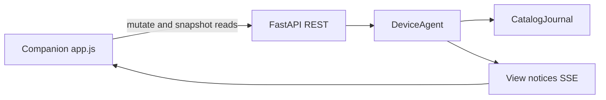

# Companion UI actions

Interaction contract for the local companion (`tunebag serve` → static UI + FastAPI). Domain nouns live in root `CONTEXT.md`. This doc is the surface jobs, verb labels, action matrix, and reactivity rules.

Implementation may lag; see **Gaps vs current code** at the end.

## Surface jobs

| Surface | Job |
|---------|-----|
| **Player** | Transport + annotate the *now-playing* Release |
| **Playlog** | Global completed (Played) past + Intent assignment now/upcoming; Queued Intent select + Play now; cover hover ▶ / ◀ / ⏸; upcoming `#` Drop (hover) / left-swipe → ⊖ confirm (touch); right-swipe → ▶ confirm (touch); Cache under Length |
| **Catalog** | Browse/filter full Catalog; manage Artists (ingest/refresh/delete); annotate any Release |
| **Intents** | Define plans; assign device hours; rebuild Sequence; cover hover Switch to intent; Fill now |
| **Cache** | Inspect File completeness; Metered |
| **Activity** | Observe local agent work (fills, syncs) — read-only |
| **Peers** | Trust lifecycle (pair/unpair) + Sync |
| **About** | Domain explanation — not an action surface |

## Shell layout

Companion `index.html` chrome (not action surfaces themselves):

1. **Sticky status bar** — `[icon menu]` · `device vX.Y.Z ⇄N` · cache (`N ♪ · duration · size`). Quiet degraded cue on version. Progressive hide on narrow viewports; hover `title` keeps full text.
2. **Player** — under the status bar; no section title. Layout stays cover | title+meta above seek+controls. Soft-compacts fold-first from focus-pane wheel/scroll (continuous, short range): cover scale 1→½, then album track titles fade/collapse while the table’s first row stays put and more rows appear as the player shrinks; only then does table content scroll. Playlog home is the default −2 scroll (player fully shown). Collapse depth sticks across tab switches until the newly active pane is scrolled; height change is absorbed by the flex shell. When the active pane is past home or the player is folded, a floating `⌃` restores home scroll and full player size.
3. **Focus tabs** — companion shell fills the viewport (no page scroll). Playlog (default) | Intents | Catalog | Cache | Peers | Activity; hash-backed (`#playlog` …); icon-only labels on small screens. Filters / Actions stay above each tab’s list (Peers: Sync; Activity has no toolbar). Playlog Filters: `[select] [▶ Play now]` (Queued Intent select + play; no label). **One scrollport:** each tab’s pane scroller moves table/list rows (remembered `scrollTop`; thead / Playlog current sticky in-pane; stable scrollbar gutter). Pane scroll/wheel also soft-collapses the Player (fold-first). **Playlog default (−2):** first visit / intent change scrolls the Playlog pane so −2 sits under its thead. Past home (or folded player): floating `⌃` jumps that pane home and fully expands the Player. Re-clicking the already-selected tab does the same (pane home + full player).

## Verb glossary

Canonical UI labels (tips / accessible names). Domain meaning in parentheses where useful.

| UI verb | Meaning |
|---------|---------|
| **Rate** | Set Rating 1–5 on a Release |
| **Tag** | Add/remove Tag on a Release |
| **Reject** | Confirm-click destructive: arm, then confirm → append Reject Event |
| **Un-reject** | Clear Reject on a Rejected Release (lists only) |
| **Play** / **Pause** / **Stop** / **Skip** / **Mark played** / **Seek** | Player transport; Playlog cover hover ▶ / ◀ / ⏸ also Play / Pause; on touch, Playlog right-swipe arms a green ▶/◀/⏸ confirm chip (tap to Play / Pause). Mark played = Last heard + Played + next; Skip = next without Played; Stop = idle at 0:00 |
| **Switch to intent** / **Play now** | Select that Intent as the Player’s current Intent and start/continue playback on its sequence; when that Intent is already playing, the control pauses (same as Player Pause). Intents cover hover uses Switch to intent; Playlog Queued Intent control uses Play now |
| **Regenerate sequence** | Full rebuild of Sequence / assignments for one Intent (explicit; Played / Skipped / Reject use Sequence fillup instead — keep remaining queue order, append only if device hours need it) |
| **Drop from sequence** | Remove one Release from this Intent’s Sequence (trim + Sequence fillup); not Played / Skipped / Reject; may re-enter later. After commit the row greys out until refresh. **Hover:** confirm-click (⊖ → 💥) on Playlog upcoming `#` and Intent Shared sequence `#`. **Touch Playlog:** left-swipe past threshold arms a red ⊖ chip (tap to Drop); swipe is preview only. **Touch Intents Shared sequence:** Drop unavailable for now (show `#` only). Not for the live current Release |
| **Refresh artist** / **Refresh all artists** | Re-ingest from origin for one / all Artists |
| **Fill now** | Metered override: fill one Intent to its full device budget |
| **Sync** | Exchange Event logs with reachable trusted Peers (+ maintenance nudge). Not “reload UI” |

### Annotate kit

Shared control set wherever a surface’s job includes annotate:

**Rate**, **Tag**, **Reject** (confirm-click), **Un-reject** (when the Release is Rejected).

Surface-specific (not in the kit): row transport on Playlog (▶ / ◀ / ⏸; touch swipe → confirm chip); Switch to intent on Intent cover hover; Drop from sequence on Playlog upcoming / Intent Shared sequence `#` (hover confirm-click; touch Playlog left-swipe → ⊖ confirm); Player transport verbs; Catalog Rejected filter chip.

## Surface × action matrix

| Action | Player | Playlog | Catalog | Intents | Cache | Activity | Peers |
|--------|--------|---------|---------|---------|-------|----------|-------|
| Rate | yes | yes | yes | — | — | — | — |
| Tag | yes | yes | yes | — | — | — | — |
| Reject (confirm) | yes | yes (if not Rejected) | yes (if not Rejected) | — | — | — | — |
| Un-reject | no | yes (if Rejected) | yes (if Rejected) | — | — | — | — |
| Play / Pause (row) | — | yes | — | — | — | — | — |
| Drop from sequence | — | yes (upcoming) | — | yes (Shared sequence) | — | — | — |
| Play / Pause / Stop / Skip / Mark played / Seek | yes | — | — | — | — | — | — |
| Switch to intent / Play now | — | yes (Queued Intent filter row) | — | yes (cover hover) | — | — | — |
| Regenerate sequence | — | — | — | yes | — | — | — |
| Fill now | — | — | — | yes | — | — | — |
| Refresh artist(s) | — | — | yes | — | — | — | — |
| Metered toggle | — | — | — | — | yes | — | — |
| Sync | — | — | — | — | — | — | yes |
| Pair / Unpair | — | — | — | — | — | — | yes |

Intent create/edit/delete and device-hours assign are Intent-surface management, not annotate.

## Soft / Hard Rejected visibility

Catalog state is a single **Reject** flag (Event-backed). Soft / Hard are UI visibility only (`CONTEXT.md`).

| Kind | Rule | Catalog default list | Catalog Rejected filter on | Playlog in-window |
|------|------|----------------------|----------------------------|-------------------|
| **Soft Rejected** | Rejected and Reject Event author time younger than 5 minutes | Shown, muted | Shown | `✕` + size |
| **Hard Rejected** | Rejected and older than 5 minutes | Hidden | Shown | `✕` (no size) when still in window |
| Not Rejected | — | Shown | Shown | normal Cache glyphs |

- Catalog keeps a Rejected filter toggle. Playlog has no Rejected filter; Soft/Hard appear only when the row is still in the assignment / previous cushion window.
- File byte deletion waits until Soft → Hard (5 minutes from Reject author time). Un-reject during Soft may still find local bytes; after Hard, Un-reject does not restore bytes (ADR-0003).
- Playlog previous-File cushion (local-only, same 5 minutes) keeps the immediate previous Release’s bytes for ◀; it is not Soft Reject.
- Player: Reject only (confirm-click). Recovery via Catalog or Playlog Un-reject.

## Backend ↔ UI

- **Mutations and reads**: HTTP REST (`/api/*`). UI never consumes the raw Event log.
- **Catalog freshness**: coalesced **View notices** (`GET /api/view-notices`) with section ids `mixes`, `playlog`, `intents`, `peers`, `cache`, `activity`, `pairing_session`, `player`. Local append and foreign ingest both mark Catalog sections; Activity notes, pairing-session transitions, and Player transport mark their sections; the UI refetches the matching snapshots.
- **Peer path**: Peer Sync / ingest → Catalog apply → View notices → UI refetch (same notice bus as local writes). Sync notes also mark `activity`.

## Reactivity rules

1. **After a user mutation**, refresh affected surfaces via the shared `refreshAffectedSurfaces` path with `force` where an open editor would otherwise skip DOM rebuild. Annotate / play controls may paint **local pending chrome** immediately (grey Rate stars, muted Reject row, Drop greying, play/pause button flip) and kick that refresh in the background so the control does not wait on the remount; Drop remains the precedent.
2. **View notices** refetch listed sections **without** `force` so in-progress editors (`focusInside`) are preserved.
3. **Non-Catalog pending** must be API-visible if the UI shows it. Reject no longer uses a pre-commit undo buffer; Soft/Hard use Reject author time on Catalog/API snapshots. Reject Catalog maintenance is Sequence fillup + async Cache fill (same shape as Skip / Mark played), so the Reject POST is not blocked on origin downloads.
4. **Activity**, **pairing session**, and **Player** are notice-driven (pairing may keep a short poll only while `pending_confirm` waits on the other device). Player seekbar position ticks locally between notices; natural end-of-Release is watched on the agent while playing.
5. **Action outcome feedback** (errors, validation, notable successes) uses the player overlay (`#player-notice`, 5s); View notices remain refetch-only. Pairing session choreography tips stay in `#pair-session-hint`.

## Out of product UI

Not user verbs in this contract (APIs may still exist until an implementation pass removes or hides them):

- Global **Fill** (all intents) — prefer Metered autofill + per-Intent **Fill now**
- Explicit **Reload UI** — SSE reconnect / section refetch is automatic; Sync is not reload
- Pending **Skip** chrome — Skip delay stays agent-only
- **Set current Release** as a core Cache verb — not part of the Cache job

## Gaps vs current code

Truth for product semantics is this doc + `CONTEXT.md` + ADR-0007. Remaining companion gaps after Intent verbs / Fill cleanup (ui-actions 05) and the shell restructure are tracked in follow-up work; About concepts live on `/about`.

Playhead Events commit on pause / stop (with position) / seek / skip / track-or-release boundary, when the agent watch sees natural **end of Release** (Last heard + Played), plus a **5‑minute** companion heartbeat while playing. Play/resume flushes prior playhead to peers without rewriting an equal-position Event. When Catalog playhead is already at Release end, Play starts at 0. Heartbeat ticks must **not** rebuild Catalog / Playlog and must **not** drive Sync / Activity chatter (peers flush on boundaries, threshold Events, or manual Sync). Activity notices refresh Activity only — never Cache. Cache invalidates on intent/assignment/sequence changes (pending/loading/cached overview) and on download start/end plus throttled origin progress; the companion coalesces overlapping Cache refetches so the newest snapshot wins. Peer copies flip status only (no byte progress bar). Throttled origin progress marks `cache` only: the companion refetches Cache and **patches** Playlog download cells from that snapshot (no full `/api/playlog` rebuild). Download start/end mark `cache` and `playlog` so Playlog remounts status/playable. Playlog also full-refetches on `player` and explicit `playlog` / Catalog-driven notices.

Follow-up implementation should close the remaining gaps against this contract.
