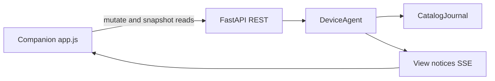

# Companion UI actions

Interaction contract for the local companion (`tunebag serve` → static UI + FastAPI). Domain nouns live in root `CONTEXT.md`. This doc is the surface jobs, verb labels, action matrix, and reactivity rules.

Implementation may lag; see **Gaps vs current code** at the end.

## Surface jobs

| Surface | Job |
|---------|-----|
| **Player** | Transport + annotate the *now-playing* Release |
| **Play history** | Browse by Last heard; annotate; resume at Playhead |
| **Catalog** | Browse/filter full Catalog; manage Artists (ingest/refresh/delete); annotate any Release |
| **Intents** | Define plans; assign device hours; rebuild Sequence; Switch to intent (start/stop that Intent’s playback); Fill now |
| **Cache** | Inspect File completeness; Metered |
| **Activity** | Observe local agent work (fills, syncs) — read-only |
| **Peers** | Trust lifecycle (pair/unpair) + Sync |
| **About** | Domain explanation — not an action surface |

## Verb glossary

Canonical UI labels (tips / accessible names). Domain meaning in parentheses where useful.

| UI verb | Meaning |
|---------|---------|
| **Rate** | Set Rating 1–5 on a Release |
| **Tag** | Add/remove Tag on a Release |
| **Reject** | Confirm-click destructive: arm, then confirm → append Reject Event |
| **Un-reject** | Clear Reject on a Rejected Release (lists only) |
| **Resume** | Play that Release in the selected Intent at Catalog Playhead (Play history) |
| **Play** / **Pause** / **Stop** / **Skip** / **Mark played** / **Seek** | Player transport (and Mark played) |
| **Switch to intent** | Select that Intent as the Player’s current Intent and start/continue playback on its sequence; when that Intent is already playing, the control pauses (same as Player Pause) |
| **Regenerate sequence** | Rebuild Sequence / assignments for one Intent |
| **Refresh artist** / **Refresh all artists** | Re-ingest from origin for one / all Artists |
| **Fill now** | Metered override: fill one Intent to its full device budget |
| **Sync** | Exchange Event logs with reachable trusted Peers (+ maintenance nudge). Not “reload UI” |

### Annotate kit

Shared control set wherever a surface’s job includes annotate:

**Rate**, **Tag**, **Reject** (confirm-click), **Un-reject** (when the Release is Rejected).

Surface-specific (not in the kit): Resume (Play history); transport verbs (Player); Rejected filter chips (Catalog and Play history, independent).

## Surface × action matrix

| Action | Player | Play history | Catalog | Intents | Cache | Activity | Peers |
|--------|--------|--------------|---------|---------|-------|----------|-------|
| Rate | yes | yes | yes | — | — | — | — |
| Tag | yes | yes | yes | — | — | — | — |
| Reject (confirm) | yes | yes (if not Rejected) | yes (if not Rejected) | — | — | — | — |
| Un-reject | no | yes (if Rejected) | yes (if Rejected) | — | — | — | — |
| Resume | — | yes | — | — | — | — | — |
| Play / Pause / Stop / Skip / Seek / Mark played | yes | — | — | — | — | — | — |
| Switch to intent | — | — | — | yes | — | — | — |
| Regenerate sequence | — | — | — | yes | — | — | — |
| Fill now | — | — | — | yes | — | — | — |
| Refresh artist(s) | — | — | yes | — | — | — | — |
| Metered toggle | — | — | — | — | yes | — | — |
| Sync | — | — | — | — | — | — | yes |
| Pair / Unpair | — | — | — | — | — | — | yes |

Intent create/edit/delete and device-hours assign are Intent-surface management, not annotate.

## Soft / Hard Rejected visibility

Catalog state is a single **Reject** flag (Event-backed). Soft / Hard are UI visibility only (`CONTEXT.md`).

| Kind | Rule | Default list (Catalog + Play history) | Rejected filter on |
|------|------|----------------------------------------|--------------------|
| **Soft Rejected** | Rejected and Reject Event author time younger than 5 minutes | Shown, muted | Shown |
| **Hard Rejected** | Rejected and older than 5 minutes | Hidden | Shown |
| Not Rejected | — | Shown | Shown |

- Catalog and Play history keep **independent** Rejected filter toggles.
- File byte deletion waits until Soft → Hard (5 minutes from Reject author time). Un-reject during Soft may still find local bytes; after Hard, Un-reject does not restore bytes (ADR-0003).
- Player: Reject only (confirm-click). Recovery via Catalog or Play history Un-reject.

## Backend ↔ UI

- **Mutations and reads**: HTTP REST (`/api/*`). UI never consumes the raw Event log.
- **Catalog freshness**: coalesced **View notices** (`GET /api/view-notices`) with section ids `mixes`, `play_history`, `intents`, `peers`, `cache`, `activity`, `pairing_session`. Local append and foreign ingest both mark Catalog sections; Activity notes and pairing-session transitions mark their sections; the UI refetches the matching snapshots.
- **Peer path**: Peer Sync / ingest → Catalog apply → View notices → UI refetch (same notice bus as local writes). Sync notes also mark `activity`.

## Reactivity rules

1. **After a user mutation**, refresh affected surfaces via the shared `refreshAffectedSurfaces` path with `force` where an open editor would otherwise skip DOM rebuild.
2. **View notices** refetch listed sections **without** `force` so in-progress editors (`focusInside`) are preserved.
3. **Non-Catalog pending** must be API-visible if the UI shows it. Reject no longer uses a pre-commit undo buffer; Soft/Hard use Reject author time on Catalog/API snapshots.
4. **Activity** and **pairing session** are notice-driven (pairing may keep a short poll only while `pending_confirm` waits on the other device). **Player** transport/position may remain a lightweight poll/tick until a cheap push exists.

## Out of product UI

Not user verbs in this contract (APIs may still exist until an implementation pass removes or hides them):

- Global **Fill** (all intents) — prefer Metered autofill + per-Intent **Fill now**
- Explicit **Reload UI** — SSE reconnect / section refetch is automatic; Sync is not reload
- Pending **Skip** chrome — Skip delay stays agent-only
- **Set current Release** as a core Cache verb — not part of the Cache job

## Gaps vs current code

Truth for product semantics is this doc + `CONTEXT.md` + ADR-0007. As of the docs-only pass, the companion still roughly does the older model:

- Reject uses a ~20s undo buffer (`reject_pending_until`) and early File delete; no Soft/Hard visibility
- Player lacks Un-reject (aligned) but still shows Undo, not confirm-click
- Intent row still labeled/acts like Play rather than **Switch to intent**; sequence control tip may say Refresh
- Cache still exposes global Fill and related chrome
- Player still polls while playing (transport/position)
- Section ⓘ copy in `index.html` may lag (SoundCloud-only ingest wording, rate/reject undo wording)

Follow-up implementation should close these gaps against this contract.
